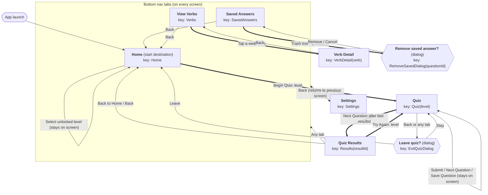

# User Flow: ConjuQuiz

**Legend:** rectangle = screen, hexagon = dialog, **thick arrow** = carries an argument.
**Start destination:** Home. Home, Saved Answers and View Verbs are bottom-nav tabs available from every screen. The gear icon opens Settings from any screen.

